# Architecture Océan V11

Base : PR #5, `4e2624f`. Python 3.11+, bibliothèque standard, aucun service
payant requis. Les modules sont des rôles du même processus ; aucun essaim
d'agents ou modèle obligatoire.

```mermaid
flowchart LR
  G[Objectif autorisé] --> P[ocean_plan : profil et lacunes]
  P --> R[ResearchSessions V10 : file, verrou, budgets]
  R --> W[ocean_web : découverte, robots, cache]
  W --> K[ocean_knowledge : attribution et propositions]
  K --> N[Markdown candidat immuable + SQLite existant]
  N --> M[OceanAPI : briefing MCP et Obsidian]
  M --> L[Laboratoire isolé : mesures et limites]
  L --> M
```

## Planification et reprise

`ocean_plan.py` décompose le profil forêt en douze facettes : collisions,
cartes de feuillage, géométrie, PBR, neige, sol, nuit/brouillard, lampe, vent,
performances/placement, export, comparaison Unreal. Les acquisitions sont
indépendantes ; les prérequis de production restent explicites. Les priorités
et alternatives viennent de règles de domaine lisibles. Ce secours déterministe
ne prétend pas comprendre un domaine arbitraire : un objectif inconnu s'abstient.

`ocean.py` ajoute une enveloppe `lab/ocean/goals/UUID.json` au **même UUID** de
session V10. Il réutilise `ResearchSessions`, `ResearchQueue`, `Budget`, le verrou
racine, les quotas journaliers et leurs réservations persistées avant effet.
Les plafonds V10 restent 6 HTTP/tick, 12/session, 12 ticks, 60 s de calcul
réservé/session, 20 s/tick, 24 branches et profondeur 2. Les plafonds journaliers
existants s'appliquent aussi. Chaque relance manuelle exécute un tick au plus.

Les phases contrôlent pause/stop et l'espace disque. Une requête déjà engagée
reste coopérative jusqu'à sa fin ou son timeout. Après arrêt contrôlé, aucune
unité ne reste `running`. Après crash dur, le mécanisme V10 récupère la file
avec les réservations conservées ; un verrou occupé doit être traité selon
le guide V10, jamais effacé pendant un processus actif.

Une fiche déterministe est écrite **avant** le modèle facultatif. Sa clé est
liée à la facette, aux empreintes de contenu et aux extraits. Reprise identique :
déduplication ; source modifiée : nouvelle fiche, ancienne conservée. Réutiliser
une candidate fraîche évite une acquisition, sans valider son usage dans le jeu.
`queries_avoided_lower_bound` compte ces unités logiques, pas des HTTP économisés
ni du temps humain. Une configuration révoquant réseau/fournisseur ou réduisant
les plafonds est prise en compte à la relance.

## Collecte et confiance

`ocean_web.py` réutilise `providers.http_get`, les retries et le Budget V10.
Robots, redirections, retries, documents et modèles partagent le budget HTTP.
Un hit cache n'est pas un téléchargement. La découverte lit les pages initiales
puis classe leurs liens documentaires ; elle a réellement trouvé une page
Roblox hors des seeds. Ce n'est pas un moteur de recherche global d'Internet.

Registre JSON configurable : Roblox, Blender, Unreal ; GitHub public facultatif
désactivé. Un fournisseur supplémentaire exige hôtes, URL de départ et politique
d'usage autorisés. DevForum, articles, bibliothèques ou transcriptions ne disposent
pas d'adaptateurs spécialisés validés ici. Aucune extraction de vidéo privée.

Transport par défaut : HTTPS public, hôtes exacts, aucun jeton implicite, DNS
public vérifié au moment de connexion, IP épinglée et TLS/SNI vérifiés. Les IP
internes, chemins locaux, credentials URL et redirections inter-origines sont
refusés. Les robots s'appliquent aussi aux destinations de redirection ; les
refus 401/403/429/challenges interrompent la collecte. Un robots 404 explicitement
identifié utilise la règle RFC 9309, sans contourner un refus d'accès.

Mode exceptionnel `trusted_system_proxy` : nécessite `trust_system_proxy=true`
et un proxy HTTPS hérité réellement configuré. Il conserve ses certificats et
vérifie le DNS public, mais **délègue la résolution et le filtrage de destination
au proxy de confiance**. Cette frontière est distincte de la connexion épinglée
directe. Ce mode a été nécessaire dans l'environnement Cloud de validation ;
il n'est pas activé dans le dépôt. Aucun certificat désactivé.

Cache privé : texte extrait limité à 32 000 octets UTF-8, SHA du texte reçu et
extrait, date de consultation, publication seulement si métadonnée explicite,
version inconnue sinon, indicateurs de troncature/changement. Les fiches publiées
contiennent au plus 24 mots cités/source, liens et propositions. Les traces
contiennent des métadonnées, sans corps, clés ou query strings. La limite Océan
de 8 Mo couvre `lab/ocean` et `knowledge/ocean`, avec 32 Mo libres requis ; elle
ne prétend pas plafonner tout le laboratoire historique.

## Analyse, mémoire et interface

`ocean_knowledge.py` : sélection de passages littéraux, contrôle d'attribution,
paramètres présents dans la source, propositions de procédures spécifiques à
la facette et protocole non exécuté. Les instructions de pages ne deviennent
ni commandes, ni outils, ni requêtes libres de suivi. Un modèle peut proposer
des questions/étapes attribuées, jamais devenir une source indépendante. La
compréhension générale, les contradictions implicites et la validité technique
exigent encore une revue. Les notes corrompues sont isolées et diagnostiquées,
sans réécriture silencieuse.

Les états `DISCOVERED`, `EXTRACTED`, `SYNTHESIZED`, `SOURCE_SUPPORTED`,
`EXPERIMENTALLY_TESTED`, `HUMAN_REVIEWED`, `DISPUTED`, `OUTDATED` sont des facettes,
pas une échelle de vérité. La génération n'attribue que les quatre premiers.
Les statuts historiques demeurent ; aucune promotion automatique `VERIFIED`.
Les désaccords explicites/états périmés sont exposés dans les briefings ; aucune
détection exhaustive de contradiction naturelle n'est revendiquée.

Recherche lexicale V10 conservée ; recherche Océan avec concepts FR/EN et
diversification, puis vecteurs Ollama facultatifs + fusion RRF. Le cache de
vecteurs est lié aux modèles et empreintes. Les pages `_ocean_*` d'export ne
sont pas réingérées comme preuves indépendantes.

`ocean_api.py` fournit neuf outils de plus ; `mcp_v8.py --v11` expose 22 outils,
dont les 13 V10. Lecture sans permission d'écriture. `--allow-research` et
`--allow-experiments` sont deux capacités distinctes. La collecte exige aussi
la configuration réseau et `allow_network`. Aucun outil n'édite le jeu.

## Diagnostics

`stop_details` indique `scope=tick/session/daily/library/operator`, ressource,
limite et usage. `session.last_tick` distingue réservations HTTP et tentatives
logiques. `session.last_collection` concerne **une seule dernière unité**.
`goal.last_summary.collection` agrège toutes les unités du dernier tick exécuté,
dont fiches créées avant une erreur ultérieure. Un `ERROR` peut donc conserver
un progrès utile. Les compteurs de réponses HTTP ne signifient pas pages valides.

Voir [preuves réelles](LIVE_VALIDATION.md), [modèles](MODELS.md),
[migration](BACKUP_MIGRATION.md) et [rapport](../V11_REPORT.md).
